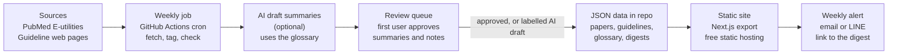
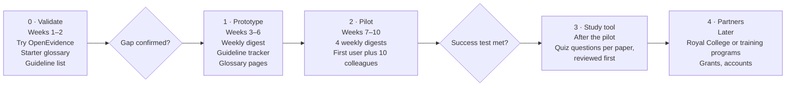

# Ophthalmology Evidence Tracker — Blueprint

As of 25 Oct 2026 · Christopher Stampfer

## Summary

A weekly tracker that tells ophthalmologists in Thailand which guidelines changed and which new high-evidence studies matter, across all subspecialties, with every abbreviation spelled out correctly.

- **For:** practising ophthalmologists and residents in Thailand, starting with one ophthalmologist at a provincial hospital in Ayutthaya as first user and clinical adviser.
- **Problem:** keeping up takes hours of searching Google and old study material, and general AI tools misread ophthalmology abbreviations.
- **v1:** guideline tracker, weekly evidence digest, reviewed abbreviation glossary. English content.
- **Later:** a study tool with reviewed quiz questions on new research.
- **Cost:** zero-cost prototype on free hosting; AI summaries optional at a few cents a week.

## Problem and first user

The first user wants fast, trustworthy guideline updates backed by strong evidence; everything else is secondary. Her answers to five questions (25 Oct 2026):

| Question | Her answer | What it means for the product |
| --- | --- | --- |
| How do you keep up with research? | Google and the internet, plus old reference material; takes a few hours | Main pain: time. The product must save hours, not add reading. |
| English, Thai or mix? | Mostly English | Content stays in English. No translation needed; a Thai interface is optional. |
| Where do you discuss cases? | LINE group with her professor | Case discussion already works. No forum in v1. |
| What annoys you about current tools? | AI (Claude) confuses ophthalmology abbreviations | A reviewed abbreviation glossary is a core feature, not an extra. |
| What would save you an hour a week? | Fast research of guideline updates with strong evidence | The two core features: guideline tracker and high-evidence digest. |

Open question: test with more ophthalmologists (her colleagues, residents) to confirm these needs are shared.

## Existing tools and where this fits

Free AI search and question banks already exist, so this product competes on a weekly "what changed" view, correct abbreviations, and Thai context, not on AI search.

| Tool | What it does | Gap this product fills |
| --- | --- | --- |
| [OpenEvidence](https://www.businesswire.com/news/home/20260609612798/en/) | Medical AI search; AAO Preferred Practice Patterns included free for ophthalmologists worldwide since June 2026 | Answers questions you ask; does not push a weekly list of what changed. US-centred. |
| [ChatGPT for Clinicians](https://www.iatrox.com/blog/chatgpt-for-clinicians-vs-openevidence-2026) | Free clinician AI, launched April 2026 | Same: on-demand, not a tracker; abbreviation errors are the first user's complaint |
| [AAO Ophthalmic Education app](https://www.aao.org/young-ophthalmologists/yo-info/article/top-ophtho-apps-useful-for-residents) | EyeWiki, Wills Eye Manual, case challenges, news and literature | AAO-centred; not Thai or Asia-Pacific guidelines |
| [OphthoQuestions](https://www.aao.org/young-ophthalmologists/yo-info/article/top-ophtho-apps-useful-for-residents), [OphthaMCQ](https://www.saashub.com/ophthamcq) | Board-exam question banks (4,000+ and 20,000+ questions) | Static exam prep; not tied to new research |
| PubMed alerts | Free saved-search emails | Raw, unfiltered lists; no evidence level, no guideline tracking |

Action before building: the first user tries OpenEvidence for one week. Whatever it fails to do becomes this product's feature list.

## Product scope

v1 covers all ophthalmology subspecialties with three features; the study tool comes in phase 3.

**v1 (prototype)**

1. **Guideline tracker.** Every guideline the first user relies on, grouped by subspecialty, with current version date, issuing body and link. An item is flagged "Updated" when a new version appears, with a short reviewed note on what changed.
2. **Weekly evidence digest.** New randomized controlled trials, systematic reviews, meta-analyses and practice guidelines from PubMed, filtered to ophthalmology and tagged by subspecialty. Each item: citation, publication type, link, and a short summary labelled as AI-written or reviewed.
3. **Abbreviation layer.** A glossary reviewed by the first user. Abbreviations in summaries are expanded on hover, and ambiguous ones show the meaning that fits the subspecialty.
4. **Filters and alerts.** Filter by subspecialty and evidence type; a weekly email or LINE notification with the digest link.

**Subspecialties:** cornea and external disease, cataract and refractive, glaucoma, retina and vitreous, uveitis, neuro-ophthalmology, oculoplastics and orbit, paediatric ophthalmology and strabismus, ocular oncology, plus general ophthalmology.

**Later (phase 3):** study tool. Each digest item can get 3–5 quiz questions, drafted by AI and published only after review.

**Out of scope for now:** forum (LINE already works), dataset analysis, user accounts, translation of papers, anything that interprets patient data.

## Principles

Every item points to its source and date, and nothing reads as clinical advice.

1. **Source and date on everything.** Each guideline, paper and summary shows where it came from, when it was retrieved, and when it was last checked.
2. **AI output is labelled.** Summaries show "AI draft" until reviewed, then "Reviewed by [name], [date]". Guideline "what changed" notes and quiz questions are only published after review.
3. **Information, not advice.** The tracker reports what the literature and guidelines say. It never recommends treatment for a patient. A short notice on every page says so.
4. **Copyright respected.** Show titles, citation data, links and our own short summaries. Do not republish full abstracts or paper text unless the licence allows (for example open-access CC-BY articles).
5. **No patient data.** Nothing uploaded or stored about patients, so PDPA health-data rules do not apply to v1.
6. **Reviewer time is the limit.** Scope the weekly volume to what one reviewer can check in about an hour.

## Sources

PubMed feeds the weekly digest automatically; guidelines are tracked from a hand-curated list checked on a schedule, with links only.

**Literature feed**

| Source | Covers | How we use it | Limits and licence |
| --- | --- | --- | --- |
| [PubMed E-utilities](https://www.ncbi.nlm.nih.gov/books/NBK25497/) | All indexed ophthalmology journals | Weekly query by ophthalmology MeSH terms and publication type (RCT, systematic review, meta-analysis, practice guideline); store PMID, title, journal, date, type, DOI | 3 requests/second without a key, 10 with a free key ([NLM](https://support.nlm.nih.gov/kbArticle/?pn=KA-05510)); register tool name and email. Citation data free; abstracts belong to publishers, so we link instead of republishing |
| PubMed Central open-access subset | Full text of open-access papers | Optional source for summaries where the licence is CC-BY | Check each article's licence |

**Guidelines to track (starter list, to confirm with the first user)**

| Issuer | Example guidelines | Current version noted | Use |
| --- | --- | --- | --- |
| American Academy of Ophthalmology | Preferred Practice Patterns, all subspecialties | Track per guideline | Link and version date only; content is AAO copyright |
| [European Glaucoma Society](https://www.eugs.org/educational_materials/190) | Terminology and Guidelines for Glaucoma | 6th edition | Link and version date |
| [International Council of Ophthalmology](https://icoph.org/?p=4870) | Diabetic eye care; glaucoma eye care (low, mid and high resource settings) | Track per guideline | Link; ICO encourages non-commercial adaptation with credit ([ICO](https://icoph.org/?p=3858)) |
| Royal College of Ophthalmologists of Thailand | Thai clinical practice guidelines | Unknown | Open question: where they are published and in what form |
| Asia-Pacific societies (e.g. APAO, regional glaucoma and retina societies) | Regional consensus statements | Unknown | To confirm with the first user |
| Cochrane Eyes and Vision | Systematic reviews | Via PubMed feed | Link |

Guideline pages rarely offer feeds, so v1 checks each tracked page weekly for a changed version or date and puts any change in a review queue. No guideline text is copied.

## Abbreviation layer

A glossary reviewed by the first user is the single source of truth for every abbreviation the product shows or sends to an AI model.

1. **Seed list.** Collect abbreviations from the digest items as they come in, plus a starter list the first user writes from daily practice. AI may suggest expansions, but nothing is marked approved without her review.
2. **Context-aware entries.** One abbreviation can have several meanings. Each meaning is stored with its subspecialty, so a glaucoma paper and a retina paper can expand the same letters differently. If the context is unclear, the item is flagged for review rather than guessed.
3. **Used everywhere.** Summaries show the expansion on hover. The approved glossary is also passed to the AI model as fixed terminology when it writes summaries, so it stops guessing.
4. **Exportable.** The glossary can be exported as a file the first user can give to Claude or other AI tools in her daily work. This is useful on day one, before anything else ships.
5. **Small at first.** Start with the 100–200 abbreviations she actually meets most often; grow from what the digest surfaces.

## Data model

Six JSON collections in the repo for the prototype, shaped so they can move to Postgres with Drizzle later without changes.

```ts
subspecialties { id, slug, name }                      // cornea, glaucoma, retina, ...

sources { id, name, url, licence, retrieved_at }       // PubMed, EGS, ICO, AAO ...

guidelines {
  id, title, issuer, subspecialty_ids[], url,
  version_label, version_date, last_checked_at,
  status: 'current' | 'updated' | 'superseded',
  change_note, change_note_status: 'ai_draft' | 'reviewed',
  reviewed_by, reviewed_at, source_id
}

papers {
  id, pmid, doi, title, journal, pub_date,
  publication_types[],                                 // RCT, systematic review, meta-analysis, guideline
  subspecialty_ids[], url, open_access_licence,
  summary, summary_status: 'none' | 'ai_draft' | 'reviewed',
  reviewed_by, reviewed_at, retrieved_at, source_id
}

abbreviations {
  id, abbr, expansion, subspecialty_id (nullable),     // one row per meaning
  notes, status: 'suggested' | 'approved',
  approved_by, approved_at
}

digests { id, week_start, paper_ids[], guideline_ids[], published_at }

// phase 3
quiz_questions { id, paper_id, question, options[], answer_index,
  explanation, status: 'ai_draft' | 'reviewed', reviewed_by, reviewed_at }
```

## Zero-cost architecture

No server and no database: a weekly job writes JSON files to the repo, and a static site reads them.



The review queue is the only manual step; items not yet reviewed still appear, clearly labelled as AI drafts.

| Layer | Choice | Cost |
| --- | --- | --- |
| Site | Next.js static export, TypeScript, Tailwind | Free |
| Hosting | GitHub Pages or Vercel free tier | Free |
| Data | JSON files in the repo, Zod-validated | Free |
| Scheduled job | GitHub Actions weekly cron | Free within monthly minutes |
| Literature | PubMed E-utilities with a free API key | Free |
| Search and filters | In the browser (e.g. Fuse.js) | Free |
| Review queue | A simple admin page or a JSON file edited in VS Code | Free |
| Alerts | GitHub Actions sends an email or LINE message with the digest link | Free at this volume (check LINE messaging quotas) |
| AI summaries | Optional; only for the capped weekly list | A few cents a week |

Later, if funded: Postgres with Drizzle (NexuSol stack), accounts, Thai interface.

## Phases

About ten weeks of evenings and weekends to a tested pilot, with two points where the project can stop cheaply.



- **Gate 1, gap confirmed:** after a week with OpenEvidence, the first user can name what it fails to do for her. If nothing, stop or rethink.
- **Gate 2, success test met:** see the success test under Risks. If not met, keep it as a personal tool and portfolio piece.
- **Phase 3 study tool:** 3–5 multiple-choice questions per selected paper, drafted by AI from the paper and the glossary, published only after review. Builds on the same data; no accounts needed at first (progress kept in the browser).
- Week counts are estimates for part-time work and will move.

## Risks, open questions and success test

The biggest risk is reviewer time: one ophthalmologist cannot review all subspecialties every week, so volume rules matter more than features.

| Risk | Mitigation |
| --- | --- |
| Too many papers to review across all subspecialties | Show only high-evidence types by default; cap the digest (e.g. 15–25 items a week); unreviewed summaries stay clearly labelled |
| AI summary or abbreviation error | Locked glossary; "AI draft" label until reviewed; link to the original on every item |
| OpenEvidence or similar adds a weekly digest | Keep the edge that is hard to copy: reviewed glossary, Thai and Asia-Pacific guidelines, curation by practising Thai ophthalmologists |
| Guideline pages change layout, breaking change checks | Weekly check flags failures for manual review instead of failing silently |
| Copyright | Titles, links and own summaries only; full text only under open licences |

**Open questions**

- Where are Thai Royal College guidelines published, and which ones does she use?
- Which journals and guidelines does she trust most per subspecialty?
- Would colleagues or residents help review their own subspecialty?
- Digest by email, LINE, or both?

**Success test (after 4 weeks of weekly digests):** the first user opens every digest and says it saves her time, and at least 5 of 10 invited colleagues come back in week 3 or 4.

## First Claude Code tasks

The first build session produces a working weekly digest from real PubMed data, viewable as a static site.

- [ ] Scaffold a static Next.js (App Router, TypeScript) site with Tailwind and a light, clean health-tech theme; static export for GitHub Pages or Vercel free tier
- [ ] Create JSON schemas and TypeScript types for the six collections in the data model, with Zod validation
- [ ] Write `scripts/fetch-pubmed.ts`: query E-utilities for the past 7 days by ophthalmology MeSH terms and publication type; respect 3 requests/second; store citation data only; map to subspecialties by MeSH term
- [ ] Seed `subspecialties.json` and a starter `guidelines.json` (EGS 6th edition, ICO diabetic and glaucoma guidelines, AAO Preferred Practice Patterns) with links and version fields; leave unknown versions empty, never guessed
- [ ] Build pages: weekly digest (filter by subspecialty and evidence type), guideline tracker, abbreviation glossary, about page with the "information, not advice" notice
- [ ] Show source, retrieval date and summary status on every item
- [ ] Add a GitHub Actions workflow that runs the fetch script weekly and commits the new data
- [ ] Glossary export to CSV and plain text for use in other AI tools
